# TheCarLauncher

A home-screen launcher for Android head units, built for a double-DIN unit on the
**UIS7862S platform (model code QF001)** in a compact hatchback. Its interface is styled after a
classic German factory infotainment system: black background, MENU tiles with blue underlines,
soft-key bars along the bottom, bordered popups and light settings bars.

Text is in Serbian (Latin) by default; English can be picked under
*Podešavanja → Jezik/Language*. The screenshots below use English.

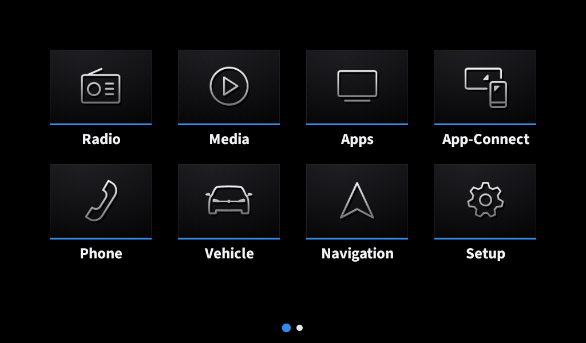

> A personal, non-commercial hobby project. Not affiliated with or endorsed by any car or
> head-unit manufacturer. See [Artwork and licences](#artwork-and-licences).

---

## Contents

- [Highlights](#highlights)
- [Screens](#screens)
  - [MENU](#menu)
  - [Media](#media)
  - [Bluetooth audio](#bluetooth-audio)
  - [Radio](#radio)
  - [Navigation](#navigation)
  - [Vehicle (CAR)](#vehicle-car)
  - [Ambient lighting](#ambient-lighting)
  - [Bass – Mid – Treble](#bass--mid--treble)
  - [Apps](#apps)
  - [Settings](#settings)
  - [Status bar](#status-bar)
- [Install on the head unit](#install-on-the-head-unit)
- [First-time setup](#first-time-setup)
- [How it talks to the head unit](#how-it-talks-to-the-head-unit)
- [Building](#building)
- [Project layout](#project-layout)
- [Testing and screenshots](#testing-and-screenshots)
- [Troubleshooting](#troubleshooting)
- [Status on real hardware](#status-on-real-hardware)
- [Reporting issues and ideas](#reporting-issues-and-ideas)
- [Artwork and licences](#artwork-and-licences)

---

## Highlights

- **Factory-style look**: factory icons, MENU tiles, soft-key bars, popups and settings bars, with
  layouts tested at 800×480, 1024×600 and 1280×720 in landscape.
- **Media player** for USB / SD / internal storage, with song, album, artist and folder browsing,
  a seekable progress bar, a soft glow under the cover while a song plays, and
  steering-wheel key support.
- **Bluetooth music without the factory app on screen**: song title, artist, album, position
  and length are read straight from the unit's Bluetooth module. Cover art is looked up
  online.
- **Built-in FM radio** that drives the unit's tuner through the MCU: presets, RDS names, a
  station list scan and the factory manual dial.
- **Navigation on OpenStreetMap**: address search, routing, turn-by-turn voice
  prompts, re-routing, nearby places.
- **Vehicle page** in the style of a factory *Vehicle status* screen, with a picture of the car, GPS trip
  computer, fuel log and service reminders. No OBD adapter needed.
- **Ambient lighting** and **Bass – Mid – Treble** pages modelled on the factory ones.
- **Phone status in the top bar**: Bluetooth, phone battery, signal and a notifications envelope.
- **True fullscreen** (no Android bars) and a smooth, GPU-accelerated MENU pager.

---

## Screens

### MENU

Eight tiles in a 4×2 grid: **Radio, Media, Apps, App-Connect, Phone, Vehicle, Navigation,
Setup**. Swipe left for a second page of pinned apps.

- The page follows your finger 1:1 and glides to rest. It turns only in the direction you dragged:
  a quarter of the screen or a quick flick. It never stretches past the first or last page.
- Android's Home button, or tapping the compass and street name in the status bar, always
  returns here.

| Page 1 | Page 2 |
| --- | --- |
|  | 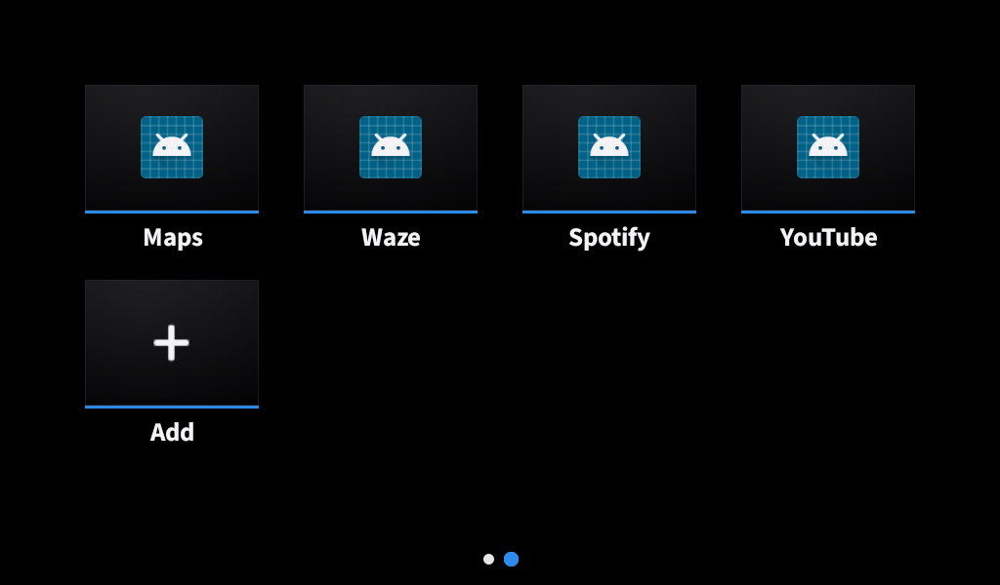 |

### Media

Soft keys: **Source · Browse · Previous · Play/Pause · Next · Setup**.

- **Source** opens the source popup: USB / SD, BT-audio, App-Connect, Radio and any other media
  app that has a media session (streaming apps, podcast players, …).
- **Browse** lists *Songs, Albums, Artists, Folders* from local storage. Tapping a song switches
  the source to the built-in player (pausing Bluetooth or the radio) and starts playback.
- The cover sits on the right, vertically centred with the title, artist and album. The progress
  bar runs across the full width; tap or drag it to seek.
- With no cover, a music-note placeholder is shown. While nothing is loaded from USB, the USB
  picture is shown.
- Picking a source pauses the previous one and starts the new one, like the factory unit.

| Playing | Source popup | Browsing |
| --- | --- | --- |
| 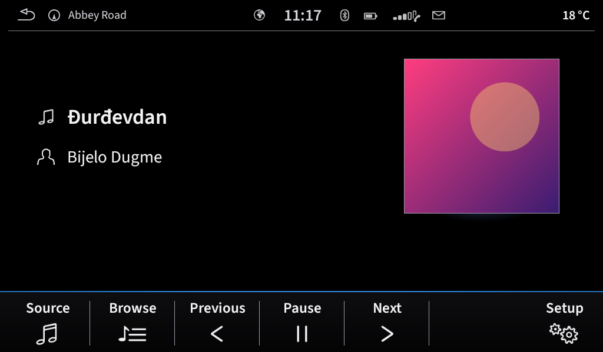 | 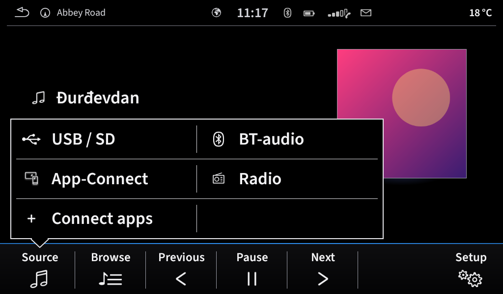 | 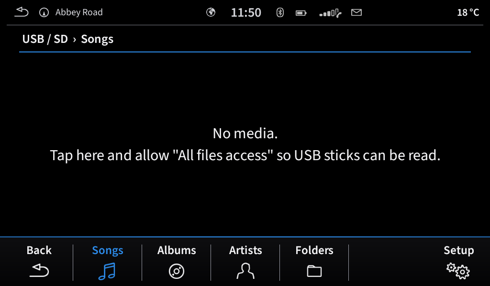 |

### Bluetooth audio

This head unit does **not** use Android's own Bluetooth stack. Its Bluetooth is a separate module run by
the `gocsdk` daemon, which the factory *Bluetooth Music* app talks to. The launcher reads the
same daemon directly over `/dev/goc_serial`:

- title, artist and album,
- song position and length (the `MT` line: 8-digit position + 8-digit length, in ms),
- playing / paused state,
- phone battery and signal for the status bar,
- disconnects. When the phone drops, the old song details are cleared and the Bluetooth picture
  is shown until the phone plays again.

Choosing **BT-audio** opens the factory Bluetooth app for about a second (the unit only switches
the audio over once its screen has opened), then brings the launcher back and tells the phone to
play. Allow **Display over other apps** for Car Launcher so Android lets it come back. Play/pause, next and previous are sent to the module as AT commands.

**Cover art.** The module only sends text, so the launcher looks the song up by artist and title in
two public music catalogues (one as a fallback for the other). Found covers are cached on the unit. This needs an internet
connection (for example a phone hotspot) and can be switched off in Settings.

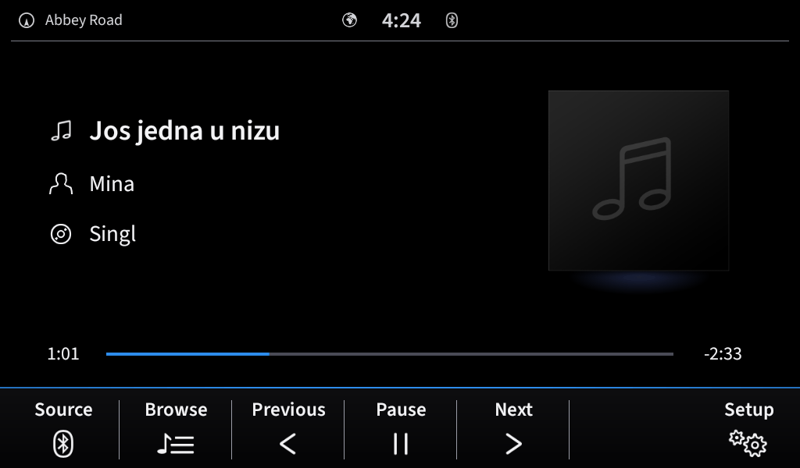

Related settings (*Setup → Bluetooth audio*):

| Setting | Default | What it does |
| --- | --- | --- |
| Song straight from the BT module | On | Reads song info from `/dev/goc_serial`. Turn it off if the factory app stops getting calls or songs. |
| Open the BT app briefly when choosing BT audio | On | The unit only plays BT audio once the factory app's screen has opened, so it is shown for about a second and the launcher comes back. Coming back needs **Display over other apps** for Car Launcher (Android blocks background starts otherwise). |
| Cover art from the internet | On | Online lookup of the cover by artist and title. |
| BT audio app | Automatic | Which app is the Bluetooth player (the factory one is hidden from the app list). |
| MCU channel for BT audio | Off | Advanced: forces an MCU audio channel. Normally not needed. |
| Diagnostics | – | Shows what the module sends (`GOC ←` lines), media sessions, factory broadcasts, MCU packets and more. |

### Radio

A built-in FM radio that controls the unit's real tuner through the MCU service.

- Large frequency display with **<** **>** seek boxes.
- Three pages of six presets with RDS station names. Tap a preset to tune, long-press to store; an
  empty slot says *Empty*.
- **Stations** scans the band into a station list.
- **Manual** shows the factory FM dial for drag-tuning; the arrows then step 0.1 MHz.
- Steering-wheel next/previous seek to the next station while the radio is the source.
- On a unit without `mcu_service`, the Radio tile opens the factory radio app instead.

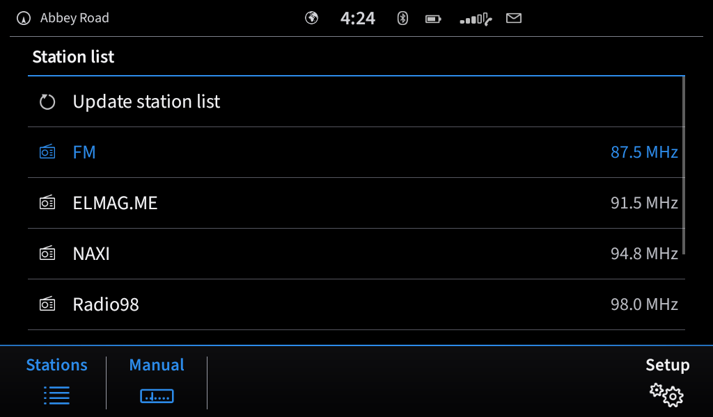

### Navigation

Built-in navigation on OpenStreetMap data (needs internet, no live traffic):

| Soft key | What it does |
| --- | --- |
| **New dest.** | Address search through **Nominatim** (1 request/s, identifying User-Agent). |
| **My dest.** | Home, work and recent destinations. |
| **Nearby** | Fuel, parking, EV chargers, car repair, cafés, restaurants, pharmacies and ATMs within 5 km, through **Overpass**. |
| **View** | Cycles through preset zoom levels. |
| **Nav app** | Hands off to an installed navigation app. |
| **Stop** | Ends guidance. |

- Routes come from **OSRM** (`routing.openstreetmap.de`, with `router.project-osrm.org` as
  fallback).
- The route is drawn on the map with a turn box, remaining distance and arrival time.
- Spoken prompts use Android text-to-speech, and the route recalculates if you leave it.
- Long-press the map to drive to that point.

| Route | Nearby | My destinations |
| --- | --- | --- |
| 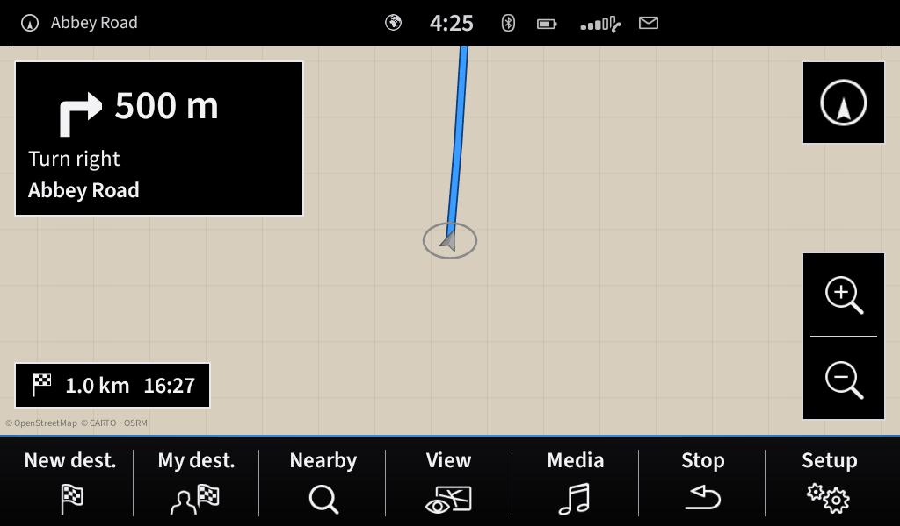 | 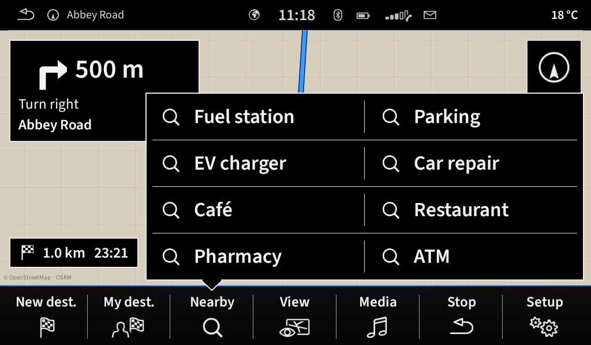 | 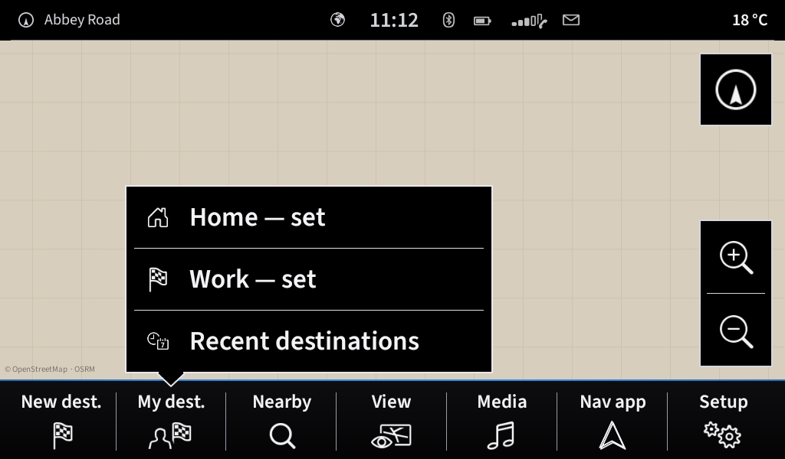 |

### Vehicle (CAR)

Paged with the **<** **>** boxes like the factory menu. Everything comes from GPS and what you
enter; no diagnostic adapter is needed.

| Page | Contents |
| --- | --- |
| **Vehicle status** | The car picture with reminders: oil change, annual service, registration expiry, winter tyres (1 Nov – 1 Apr), low fuel. Otherwise *No entries.* |
| **Since start** | Driving time, distance, average and current speed, heading and altitude (GPS). |
| **Long-term** | Totals across trips, plus the odometer. |
| **Since refuelling** | Distance, average consumption, range, last fill-up, cost per 100 km, average fuel price. |
| **Fuel** | The fuel log: add a fill-up at the pump (litres, price, odometer). |
| **Service** | Odometer, next oil change (km and date), annual service, registration date, tyres, tank size. |

| Status | Since refuelling | Fuel log | Service |
| --- | --- | --- | --- |
| 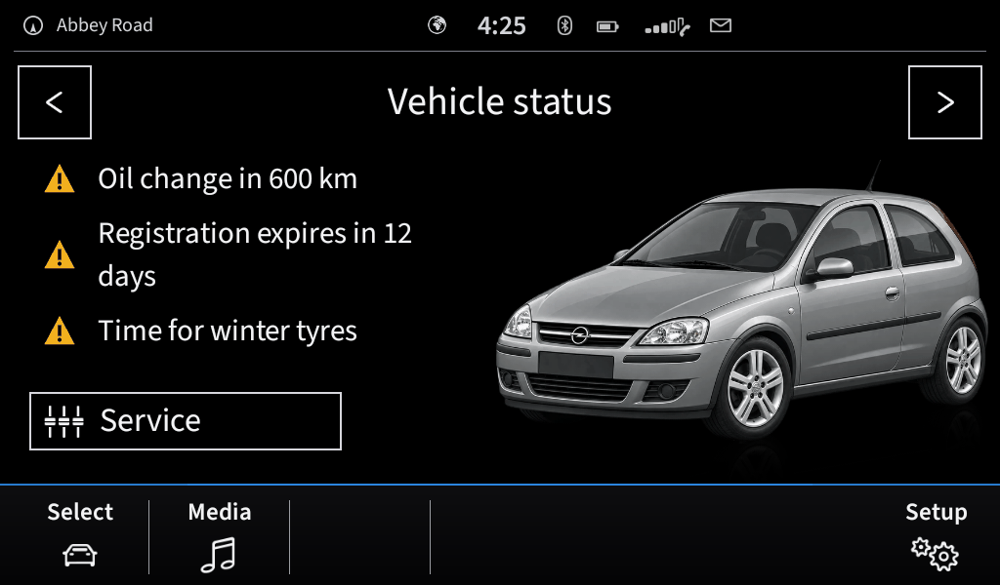 | 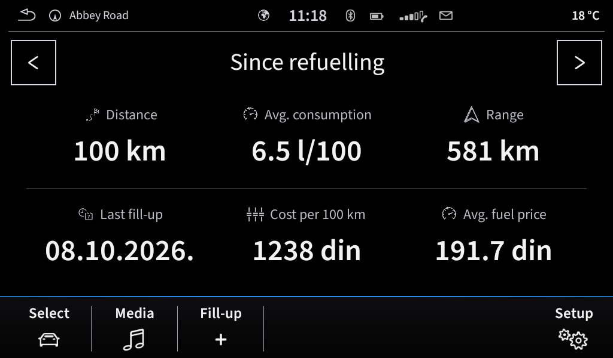 | 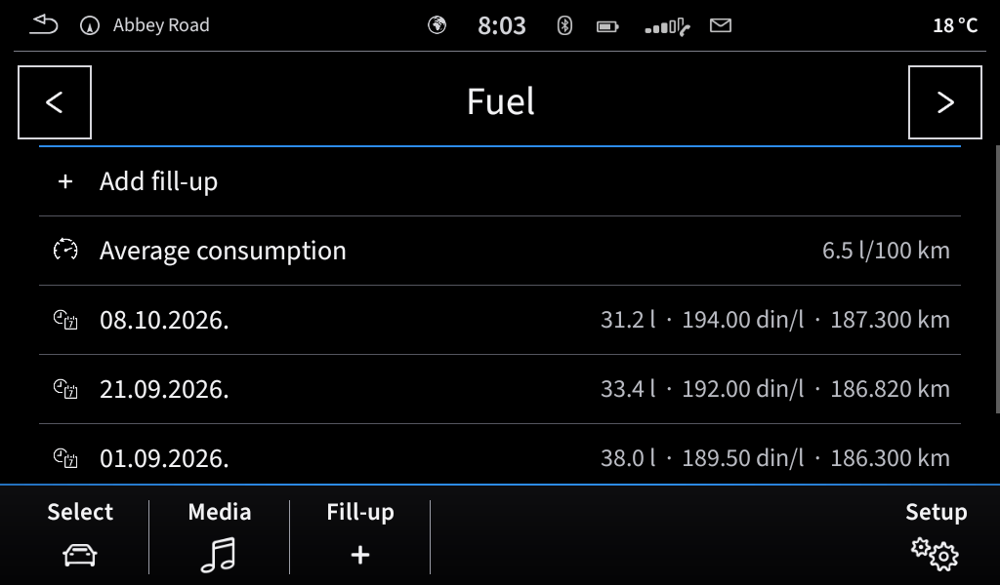 | 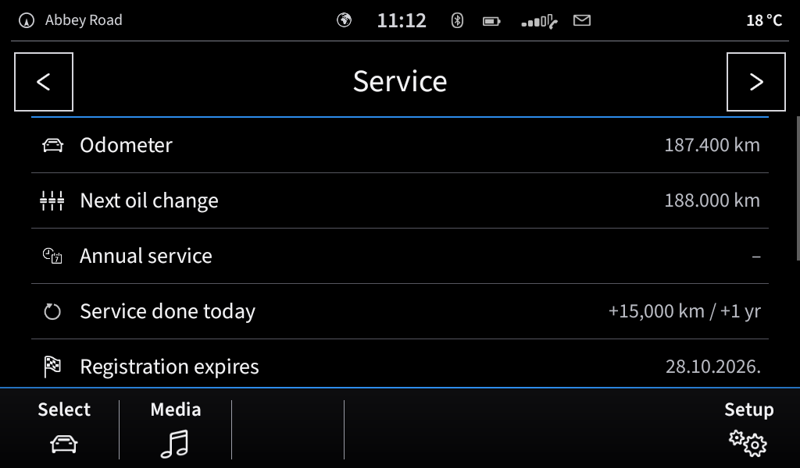 |

### Ambient lighting

A clean picture of the car's interior with a 30-colour slider along the bottom and a brightness
key (100 / 80 / 60 %). The chosen colour is used as the launcher's accent colour.

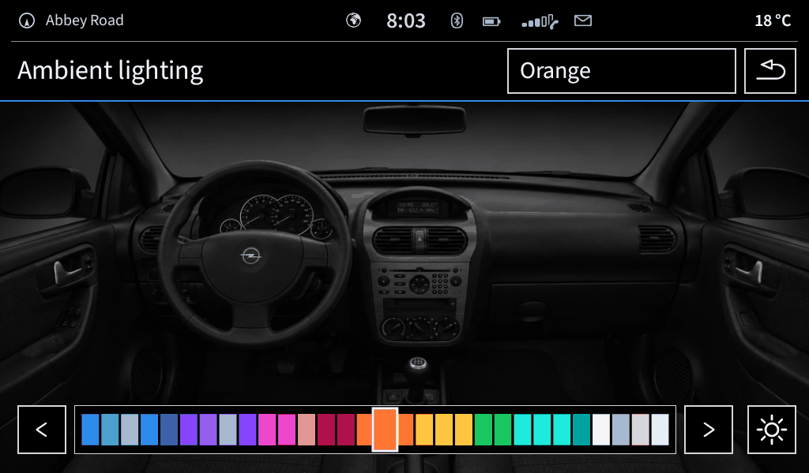

### Bass – Mid – Treble

Three factory-style sliders from −9 to +9, applied with Android's `Equalizer` to the built-in player and
the global audio session. *Reset* puts all three back to 0.

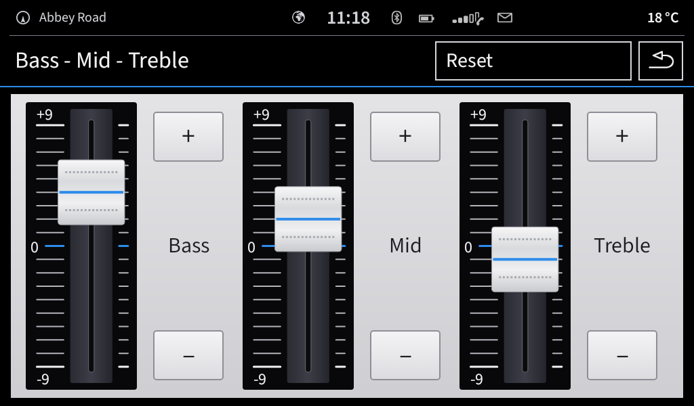

### Apps

All installed apps as tiles. Long-press a tile to add it to MENU or to use it as the phone or radio
app. The factory Bluetooth music app, which has no launcher icon, is found and listed too, along
with a **Bluetooth audio** tile that switches the media player to BT.

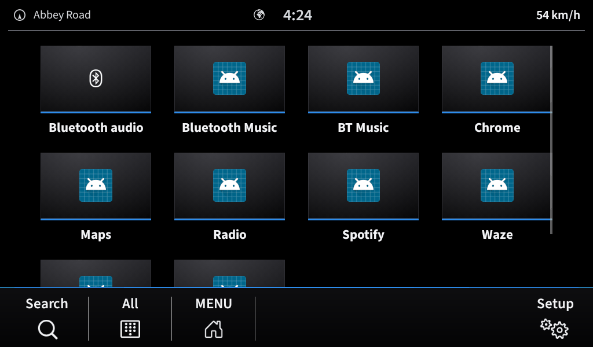

### Settings

*System settings*: screen, ambient lighting, time and date, language,
units, navigation (map style, voice), media, Bluetooth audio, App-Connect, phone and radio, vehicle,
Android settings and system information.

| Settings | Media settings | Diagnostics |
| --- | --- | --- |
| 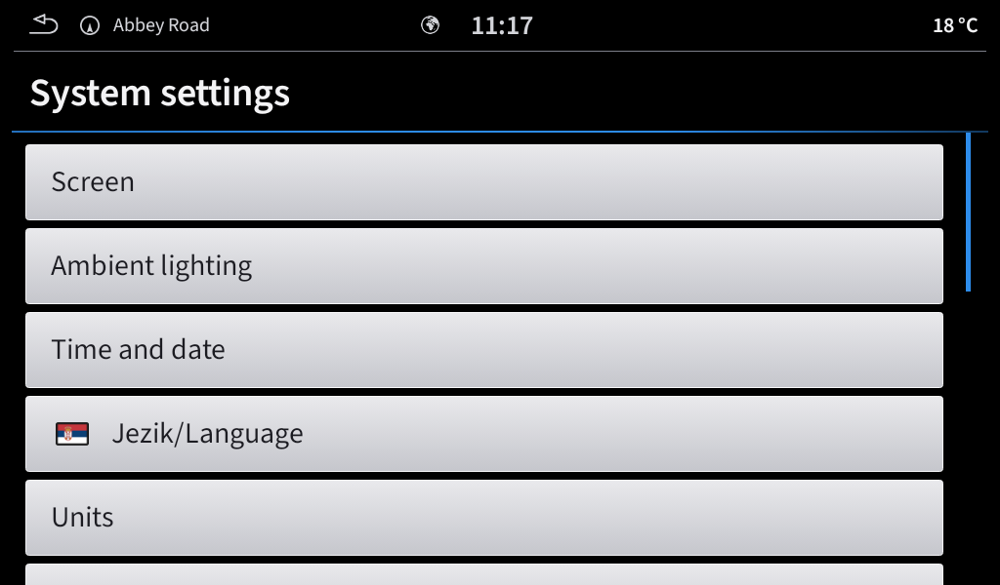 | 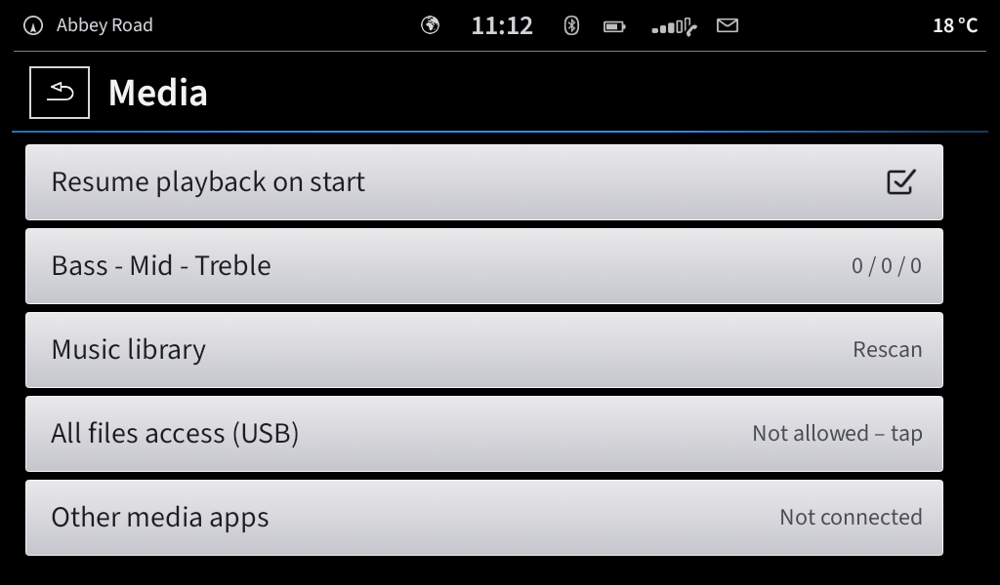 | 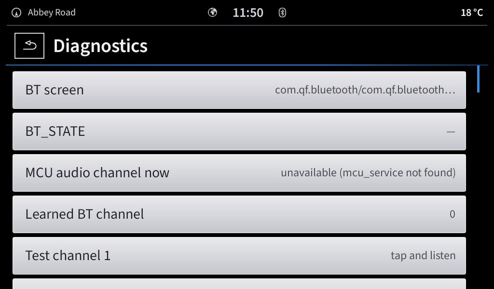 |

### Status bar

From left to right:

- **Compass and street name**: the current street from GPS and reverse geocoding. Tap it to go
  to MENU.
- **Globe**: shown dimmed when there is no internet.
- **Clock**.
- **Phone icons**: FM while the radio plays, the **Bluetooth** icon, phone **battery**,
  **signal**, and an **envelope** when the phone has notifications. Tap the envelope to list
  them.
- **Speed**: shown on the right.

The text and icons are a touch dimmer than the screen content, like the factory screen.


---

## Install on the head unit

1. Download **TheCarLauncher.apk** from the latest release on the [Releases page](../../releases).
   Every push builds one automatically (`build-N`).
2. Copy it to a USB stick, or download it on the unit, and open it. Allow *Install unknown apps*
   if Android asks.
3. Press the unit's Home button and pick **Car Launcher** → *Always*
   (or *Setup → Android system → Default launcher*).

Requires Android 5.0 or newer.

## First-time setup

| Permission | Why | Where |
| --- | --- | --- |
| Location | Map, speed, street name, trip computer | Asked on first start |
| Music / storage | Local songs from internal storage and indexed cards | Asked on first start |
| All files access (Android 11+) | Reads USB sticks and SD cards as folders, since many head units never add them to Android's media index | Opened once after the first permission dialog; also *Setup → Media → All files access (USB)* or by tapping *No media* in Browse |
| Notification access | Song info from other media apps, phone notification envelope | *Media → Source → Connect apps* |
| Bluetooth (nearby devices) | Phone status on Android 12+ | Asked on first start |

Then, in *Setup*:

- **Bluetooth audio**: leave *Song straight from the BT module* on, and play something on the
  phone to check that the title shows.
- **Radio**: check that *FM tuner* says it is available.
- **Vehicle → Service**: enter the odometer, the oil-change interval and the registration
  date so the reminders work.

---

## How it talks to the head unit

| Part | How |
| --- | --- |
| **FM tuner** | `mcu_service` / `IMcuManager` through reflection, using the tuner protocol documented by [OpenRadioFM](https://github.com/kapi21/OpenRadioFM) (Apache-2.0, see `NOTICE`). MCU channel 2 = FM, 4 = Android media. |
| **Bluetooth song info** | `/dev/goc_serial`, the Bluetooth module's AT protocol: commands `AT#<code>\r\n` (`MK` song info, `VI` state, `MA` play/pause, `MD` next, `ME` previous, `MS` play, `MJ` pause); replies are `\r`-terminated lines with fields split by byte `0xFF` (`MI` song, `MT` position/length, `MB`/`MA` playing/stopped, `PS` signal/battery, `MY`/`IA` disconnects). The factory app's audio sockets (`goc_control`, `goc_data`) and the phone-projection app's TCP port 3152 are never touched. |
| **Factory media info** | The factory media apps' `UPDATE_MEDIA_INFO`, `UPDATE_MEDIA_STATE`, `BT_STATE` and `UPDATE_ACTION` broadcasts, as a fallback. |
| **Other players** | Android `MediaSession`s, found through the notification listener. |
| **Fullscreen** | `LAYOUT_FULLSCREEN` plus `WindowInsetsController`; the UI scale is recalculated for the real screen size. |

---

## Building

### With Gradle (Android SDK installed)

```sh
./gradlew assembleRelease
# -> app/build/outputs/apk/release/app-release.apk
```

GitHub Actions (*Build APK*) runs this on every push and publishes the APK as a release named
`build-N`.

### Without Gradle or the official Android SDK

Uses Debian/Ubuntu packages only; see `scripts/build-local.sh`:

```sh
sudo apt install aapt dalvik-exchange zipalign apksigner
ANDROID_JAR=/path/to/android-all-14.jar FRAMEWORK_RES=/path/to/framework-res-34.zip \
  scripts/build-local.sh
# -> build/TheCarLauncher.apk
```

Both builds sign with `keystore/release.jks`, so either APK installs as an update over the other.
That key is committed on purpose so builds stay update-compatible. It is fine for a personal head
unit, but don't reuse it for anything published.

### Tech notes

- Plain Java 8 source, no AndroidX or other libraries.
- `minSdk 21`, `targetSdk 34`.
- `versionName` / `versionCode` live in `app/build.gradle`.

---

## Project layout

```
app/src/main/java/com/thecarlauncher/
├── LauncherActivity.java   screens, status bar, fullscreen, permissions
├── apps/                   installed apps, hidden BT music screens, launching
├── car/                    CarData: odometer, fuel log, service reminders
├── media/
│   ├── MediaHub            the single source of truth for "what is playing"
│   ├── MusicService        built-in player (MediaSession, audio focus)
│   ├── MusicLibrary        songs / albums / artists / folders from MediaStore
│   ├── GocBluetooth        /dev/goc_serial client (BT song info + controls)
│   ├── BluetoothSource     factory BT app discovery, background start, media keys
│   ├── CoverArt            online cover lookup with disk cache
│   ├── QfMediaBridge       factory media broadcasts
│   ├── PhoneStatus         phone battery / signal / notifications for the status bar
│   ├── MediaListenerService notification listener (other players' sessions)
│   └── Tone                Bass / Mid / Treble
├── mib/                    UI widgets: tiles, soft-key bar, pager, popup, progress, cover glow
├── nav/                    OsmApi (Nominatim, OSRM, Overpass), Guidance (TTS, re-route), GPS
├── radio/                  tuner driver, RadioController, FmScaleView, McuSniffer
├── screens/                Menu, Media, Radio, Nav, Vehicle, Ambient, Sound, Apps, Settings
├── util/                   Prefs, Ui, Theme
└── views/                  MapTileView, TileCache
app/src/main/res/drawable-nodpi/   UI artwork (ui_*.png), car pictures (car_*.png)
app/src/main/assets/fonts/         Source Sans 3 (OFL)
docs/screenshots/                  README screenshots
scripts/build-local.sh             Gradle-free build
```

---

## Testing and screenshots

Screens are checked with **Robolectric** at 800×480, 1024×600 mdpi and 1024×600 hdpi. The test
drives every screen, simulates GPS, media sessions, factory broadcasts and Bluetooth module replies (for example
`MT0001146900214000` → 0:11 of 3:34), and saves a screenshot of each.

The screenshots in this README come from that harness, in English, with a made-up location
(Abbey Road, London) for privacy. That is why the radio shows *tuner not available* and system
information shows *robolectric*.

---

## Troubleshooting

| Problem | What to try |
| --- | --- |
| BT music plays but no title shows | *Setup → Bluetooth audio*: make sure *Song straight from the BT module* is on. Open *Diagnostics* and tap *GOC: ask for song info*; the `GOC ←` lines should show `MI…`. |
| No sound after choosing BT-audio | Make sure *Open the BT app briefly when choosing BT audio* is on. |
| The BT app opens and stays on screen | Allow *Display over other apps* for Car Launcher (*Setup → Bluetooth audio → Allow returning from the BT app*). |
| Calls stop working in the factory app | Turn off *Song straight from the BT module* and report it. |
| No cover art | The unit needs internet. Songs whose "artist" is a video channel name may not be found. |
| Radio tile opens another app | `mcu_service` wasn't found. *Setup → Radio* shows the tuner status. |
| Other apps' songs don't show | Enable notification access: *Media → Source → Connect apps*. |
| The launcher isn't Home after a reboot | *Setup → Android system → Default launcher* → Car Launcher → *Always*. |

---

## Status on real hardware

| Feature | Status on the head unit |
| --- | --- |
| BT song title / artist / album from the module | Confirmed |
| BT position, length and full progress bar | Confirmed |
| UI, MENU, status bar, fullscreen | In daily use |
| BT-audio: app opens briefly, launcher comes back | New in 3.2.1, needs testing |
| Cover art lookup | New, needs testing on the unit's connection |
| Clearing the song on phone disconnect | New, relies on the module's `MY`/`IA` lines |
| Calls in the factory app while reading the module | Needs confirming |
| FM radio through `mcu_service` | Implemented from the OpenRadioFM protocol |

---

## Reporting issues and ideas

Open [**Issues → New issue**](../../issues/new/choose) and pick a form:

| Form | Use it for |
| --- | --- |
| **Bug report** | Something is broken or behaves wrongly. Asks for the area, steps, version, head unit and photos. |
| **Feature request / change** | A new feature, or a change to how something looks or works. |
| **Potential issue / risk** | Something that isn't broken yet but could be: untested features, side effects, driving safety, privacy, other units. |

For Bluetooth problems, attach a photo of *Setup → Bluetooth audio → Diagnostics*.

---

## Artwork and licences

- **Artwork.** The icons, tile artwork and car pictures in `app/src/main/res/drawable-nodpi/`
  (`ui_*.png`, `car_*.png`) were supplied by the project owner for this personal, non-commercial
  launcher. They remain the property of their respective owners. All trademarks belong to their
  owners; no affiliation or endorsement is implied.
- **Font.** Text uses **Source Sans 3** (SIL Open Font License,
  `app/src/main/assets/fonts/OFL.txt`) as a stand-in for the factory typeface.
- **FM radio protocol.** The tuner protocol is from OpenRadioFM (Apache-2.0); see `NOTICE`.
- **Map data.** © OpenStreetMap contributors, tiles styled by © CARTO, cached on the unit for 30
  days. Search by Nominatim, routing by OSRM (FOSSGIS), places by Overpass.
- **Cover art.** Covers are fetched from public music catalogue search results, for display only.
