# TheCarLauncher

A home-screen launcher for Android head units, built for a double-DIN unit on the
**UIS7862S platform (model code QF001)** in a compact hatchback. Its interface is styled after a
classic German factory infotainment system: black background, MENU tiles with blue underlines,
soft-key bars along the bottom, bordered popups and light settings bars.

Text is in Serbian (Latin) by default; English can be picked under
*Podešavanja → Jezik/Language*. The screenshots below use English.


> A personal, non-commercial hobby project. Not affiliated with or endorsed by any car or
> head-unit manufacturer. See [Artwork and licences](#artwork-and-licences).

---

## Contents

- [Highlights](#highlights)
- [Screens](#screens)
  - [MENU](#menu)
  - [Media](#media)
  - [Bluetooth audio](#bluetooth-audio)
  - [Radio](#radio)
  - [Navigation](#navigation)
  - [App-Connect](#app-connect)
  - [Vehicle (CAR)](#vehicle-car)
  - [Ambient lighting](#ambient-lighting)
  - [Bass – Mid – Treble](#bass--mid--treble)
  - [Apps](#apps)
  - [Settings](#settings)
  - [Back](#back)
  - [Status bar](#status-bar)
- [Install on the head unit](#install-on-the-head-unit)
- [First-time setup](#first-time-setup)
- [How it talks to the head unit](#how-it-talks-to-the-head-unit)
- [Building](#building)
- [Project layout](#project-layout)
- [Testing and screenshots](#testing-and-screenshots)
- [Troubleshooting](#troubleshooting)
- [Status on real hardware](#status-on-real-hardware)
- [Reporting issues and ideas](#reporting-issues-and-ideas)
- [Artwork and licences](#artwork-and-licences)

---

## Highlights

- **Factory-style look**: factory icons, MENU tiles, soft-key bars, popups and settings bars, with
  layouts tested at 800×480, 1024×600 and 1280×720 in landscape.
- **Media player** for USB / SD / internal storage, with song, album, artist and folder browsing,
  a seekable progress bar, a soft glow under the cover while a song plays, and
  steering-wheel key support.
- **Bluetooth music without the factory app on screen**: song title, artist, album, position
  and length come from the factory Bluetooth service running in the background. BT audio becomes
  the source as soon as the phone connects, and opening Media starts it. Pick, connect and pair
  phones from the launcher's own *Bluetooth devices* screen. Cover art is looked up
  online.
- **Built-in FM radio** that drives the unit's tuner through the MCU: presets with station
  logos, RDS names, a station list scan and the factory manual dial.
- **App-Connect** page in the factory style that drives the unit's ZLink app (Android Auto,
  CarPlay, mirroring) and shows the connection live.
- **Navigation on OpenStreetMap**: address search, routing, turn-by-turn voice
  prompts, re-routing, nearby places, and **offline maps** of whole countries drawn on the unit.
- **Vehicle page** in the style of a factory *Vehicle status* screen, with a picture of the car, GPS trip
  computer, fuel log and service reminders. No OBD adapter needed.
- **Ambient lighting** and **Bass – Mid – Treble** pages modelled on the factory ones.
- **Phone status in the top bar**: Bluetooth, phone battery, signal, a notifications envelope and
  the outside temperature.
- **Drop-down loading banner** for anything that takes a moment (radio scan, reading USB, maps,
  route, phone connecting), soft fade-in on every page, and a back arrow wherever a page has no
  back key of its own.
- **Own car pictures**: brand, model and the car / interior pictures can be set from storage.
- **True fullscreen** (no Android bars) and a smooth, GPU-accelerated MENU pager.

---

## Screens

### MENU

Eight nearly black tiles in a 4×2 grid, with no status bar, like the factory MENU: **Radio, Media,
Apps, App-Connect, Phone, Vehicle, Navigation, Setup**. Swipe left for a second page of pinned apps.

- The page follows your finger 1:1 and glides to rest. It turns only in the direction you dragged:
  a quarter of the screen or a quick flick. It never stretches past the first or last page.
- Android's Home button, or tapping the compass and street name in the status bar, always
  returns here.

| Page 1 | Page 2 |
| --- | --- |
|  |  |

### Media

Soft keys: **Source · Browse · Previous · Play/Pause · Next · Setup**.

- **Source** opens the source popup: USB / SD, BT-audio, App-Connect, Radio and any other media
  app that has a media session (streaming apps, podcast players, …).
- **Browse** lists *Songs, Albums, Artists, Folders* from local storage. Tapping a song switches
  the source to the built-in player (pausing Bluetooth or the radio) and starts playback.
- The cover sits on the right, vertically centred with the title, artist and album. The progress
  bar runs across the full width; tap or drag it to seek.
- With no cover, a music-note placeholder is shown. While nothing is loaded from USB, the USB
  picture is shown.
- Picking a source pauses the previous one and starts the new one, like the factory unit.

| Playing | Source popup | Browsing |
| --- | --- | --- |
|  |  |  |

### Bluetooth audio

This head unit does **not** use Android's own Bluetooth stack. Its Bluetooth is a separate module on
the serial line `/dev/goc_serial`, owned by the factory *Bluetooth* app (`com.qf.bluetooth`), a
persistent system service that runs from boot. The factory app's screen is never needed:

- **Phone connects → BT audio.** As soon as a phone connects over Bluetooth, BT audio becomes the
  source, exactly as if the BT-audio key had been pressed: the sound switches to Bluetooth and play
  is sent. Also works when the phone is already connected when the launcher starts.
- **Opening Media starts it.** With BT audio as the last source, opening the Media screen switches
  the sound and starts playback (once per drive, and again after the phone reconnects; a song
  paused on the phone is left alone).
- **Controls** (play/pause, next, previous) go to the factory service through its own control
  broadcast (`com.qf.action.BT.MUSIC.CONTROL`, `command` 1 previous · 2 next · 3 play/pause ·
  4 play · 5 pause). Its "play" takes Android's audio focus, and that is what switches the unit's
  sound to Bluetooth.
- **Song details**: title, artist and album from the service's `com.qf.action.BT.MUSIC.INFO`
  broadcast; position and length from the system property `sys.qf.bt.music.progress`
  (`position,length` in ms); the connection from `sys.qf.bt.is.connect`. When the phone drops,
  the song is cleared and the Bluetooth picture is shown.
- **The launcher does not read the serial line** while the factory app is installed: every byte
  read there is lost to the factory service, which then thinks the phone is gone and ignores the
  controls. The launcher only writes song-info requests (`AT#MK`) every 5 s; the service reads the
  answer and republishes it. Reading the module directly is still available as a setting for units
  without the factory app.

**Bluetooth devices.** Choosing **BT-audio** with no phone connected opens *Bluetooth devices*
instead: the phones the unit remembers, with a check mark on the left of the connected one. Tap a
phone to connect (the loading banner shows *Connecting to …* until it is connected, then BT audio
starts); tap the connected one to disconnect; long-press to forget a phone. **New device** in the
corner searches for nearby phones; tap one to pair and connect, or pick the unit's Bluetooth name on
the phone. Everything runs in the launcher through the module's own commands (`AT#MX` paired list,
`AT#CC` connect, `AT#CD` disconnect, `AT#SD`/`AT#ST` search, `AT#DB` pair); the launcher listens to
the module's answers only for those few seconds. Also under *Setup → Bluetooth audio → Bluetooth
devices*.

| Bluetooth devices | New device |
| --- | --- |
| 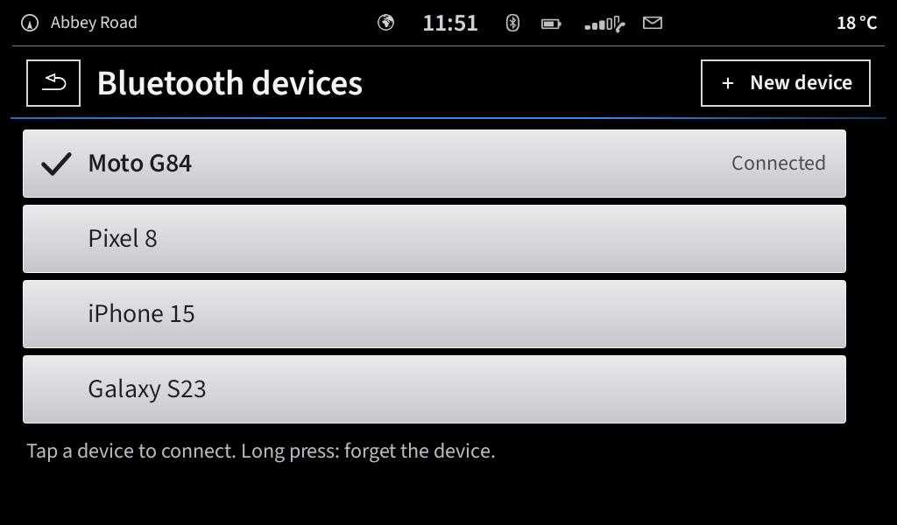 | 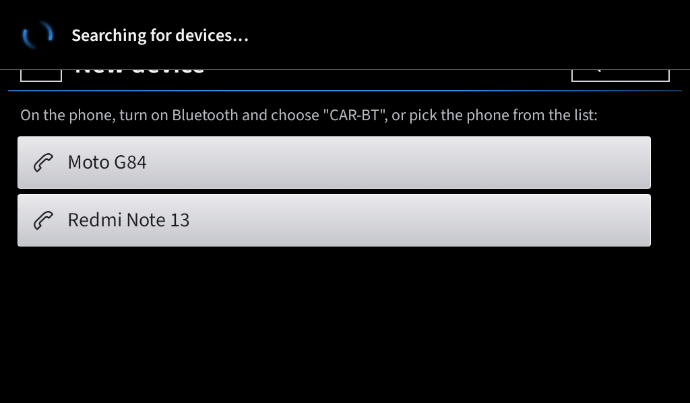 |

**Cover art.** The module only sends text, so the launcher looks the song up by artist and title in
two public music catalogues (one as a fallback for the other). Found covers are cached on the unit. This needs an internet
connection (for example a phone hotspot) and can be switched off in Settings.


Related settings (*Setup → Bluetooth audio*):

| Setting | Default | What it does |
| --- | --- | --- |
| Bluetooth devices | – | Remembered phones, connect / disconnect, pair a new device. |
| BT audio as soon as the phone connects | On | A connecting phone makes BT audio the source, like pressing its key. |
| BT audio app | Bluetooth Music | Which app receives the controls (normally the factory one). |
| Cover art from the internet | On | Online lookup of the cover by artist and title. |
| Open the BT app briefly (if there is no sound) | Off | Fallback for units where the control broadcast is not enough: shows the factory app for about a second and comes back (needs **Display over other apps** for Car Launcher). |
| Read the BT module directly | Off with the factory app | Only for units without the factory BT app; with it, reading steals the app's messages. |
| Return to launcher, BT app wait time, MCU channel | – | Fallbacks for other units. |
| Diagnostics | – | Phone battery / signal, media sessions, the song the factory app published, `sys.qf.bt.music.progress` and `sys.qf.bt.is.connect`, and the module's last lines. |

### Radio

A built-in FM radio that controls the unit's real tuner through the MCU service.

- Large frequency display with **<** **>** seek boxes.
- When the station sends its RDS name, the name replaces the frequency at the top (the frequency
  moves to the line under it).
- Three pages of six presets, shaded like the MENU tiles, with the preset number, the station's
  logo and its name under the tile.
- Station logos come from the free [Radio Browser](https://www.radio-browser.info) database by RDS
  name: fetched automatically when a station is shown, or all at once with *Setup → Radio →
  Download logos for found stations*. They are kept on the unit; none are bundled in the APK.
- Tap a preset to tune, long-press to store; an empty slot says *Empty*.
- **Stations** scans the band into a station list.
- **Manual** shows the factory FM dial for drag-tuning; the arrows then step 0.1 MHz.
- Steering-wheel next/previous seek to the next station while the radio is the source.
- On a unit without `mcu_service`, the Radio tile opens the factory radio app instead.

| Presets | Station list |
| --- | --- |
| 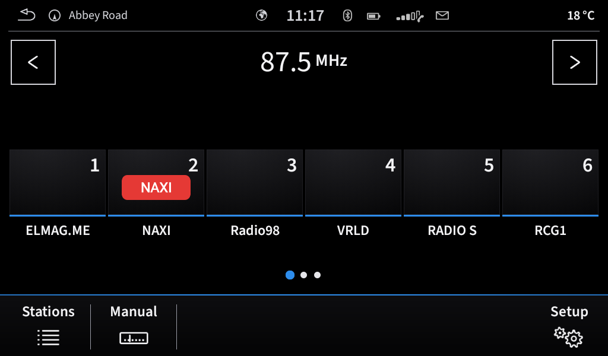 |  |

### Navigation

Built-in navigation on OpenStreetMap data (no live traffic). The map itself can work fully
offline (see [Offline maps](#offline-maps)); address search and routing need internet.

| Soft key | What it does |
| --- | --- |
| **New dest.** | Address search through **Nominatim** (1 request/s, identifying User-Agent). |
| **My dest.** | Home, work and recent destinations. |
| **Nearby** | Fuel, parking, EV chargers, car repair, cafés, restaurants, pharmacies and ATMs within 5 km, through **Overpass**. |
| **View** | Cycles through preset zoom levels. |
| **Media** | Opens a small media widget over the map (cover, song, artist, previous / play / next). Its split button puts the media in a column beside the map; long-press opens the full Media screen. |
| **Nav app** | Hands off to an installed navigation app. |
| **Stop** | Ends guidance. |

- Routes come from **OSRM** (`routing.openstreetmap.de`, with `router.project-osrm.org` as
  fallback).
- The route is drawn on the map with a turn box, remaining distance and arrival time.
- Spoken prompts use Android text-to-speech, and the route recalculates if you leave it.
- Long-press the map to drive to that point.

**Position arrow.** The arrow turns on its own centre inside the red ring and glides smoothly between
GPS fixes instead of jumping; during guidance it rides on the route line (within 25 m), pointing
along the road. The compass key in the top-right corner first brings the map back to the car; tapped
again it switches between **north up** and **driving direction up** (the map turns so the car always
points forward, with the car lower on the screen to show more road ahead; the compass needle then
shows where north is). The choice is remembered and is also in *Setup → Navigation*.

**Street name offline.** The street in the top-left corner comes from the downloaded offline maps
first (the nearest named road, preferring one that runs the way the car drives), so it keeps working
with no internet. Without a map for the area it falls back to the online lookup.

| Route | Nearby | My destinations |
| --- | --- | --- |
|  |  |  |

**Media while navigating.** *Media* opens a small widget over the map with the cover, song and
previous / play / next; it hides itself after 10 seconds. Its split button keeps the media in a
column beside the map (remembered); long-press *Media* for the full Media screen.

| Media widget | Split screen |
| --- | --- |
| 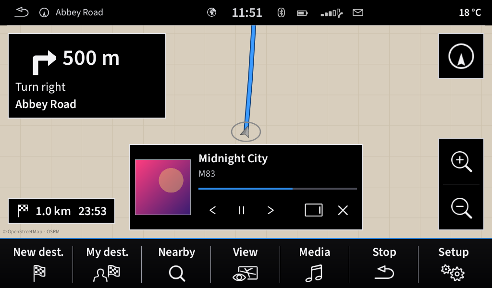 | 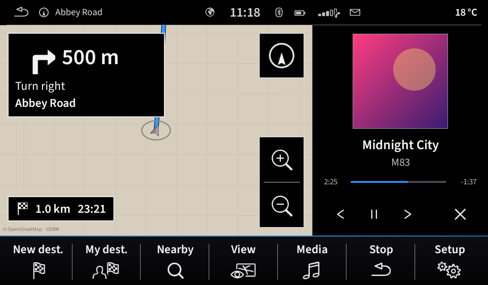 |

#### Offline maps

Whole countries or regions can be downloaded and are then drawn on the unit itself, in a soft
factory-navigation day style, with no internet at all.

- *Setup → Navigation → Offline maps → Download a map*: pick a continent, then a country (large
  countries are split into regions). Sizes are shown next to each map.
- Downloads run in the background with progress in the list and in Android's notifications.
- Inside a downloaded area the offline map is always used; elsewhere the online map is shown.
  *Use offline map* switches this off.
- Tap a downloaded map to delete it.
- Maps are OpenStreetMap vector files in the open mapsforge format, from
  `download.mapsforge.org`. They are stored in the launcher's own folder, so no storage
  permission is needed.

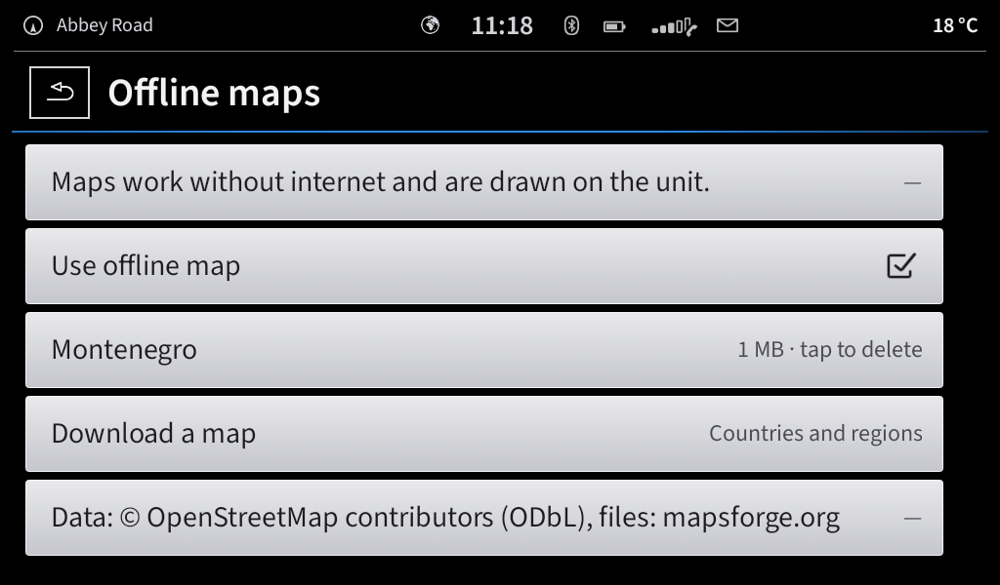

### App-Connect

A factory-style App-Connect page: *"Welcome to App-Connect. Please connect a device using the USB."*
with the three phone-mode logos along the bottom (Android Auto, Apple CarPlay, MirrorLink, from the factory artwork) and
*Info* / *Setup* soft keys.

- The projection itself is done by the unit's ZLink app. The launcher keeps ZLink's background
  service running while the page is open and starts the chosen mode through ZLink's public screens.
- ZLink's status broadcast (`com.zjinnova.zlink`, extras `status` and `phoneMode`) shows which
  phone is connected; the page then highlights that mode and a tap shows the phone.
- While a phone connects, a framed box appears in the middle with the phone's name above it and
  the mode's logo inside; the loading banner says "Connecting: Apple CarPlay…". Once connected the
  box turns white with the logo in dark, the banner says "… connected", and the phone's screen
  opens by itself.
- *Setup* opens ZLink's own settings. Without ZLink, the page falls back to any other projection
  app found on the unit.

| Waiting for a phone | Connecting | Connected |
| --- | --- | --- |
| 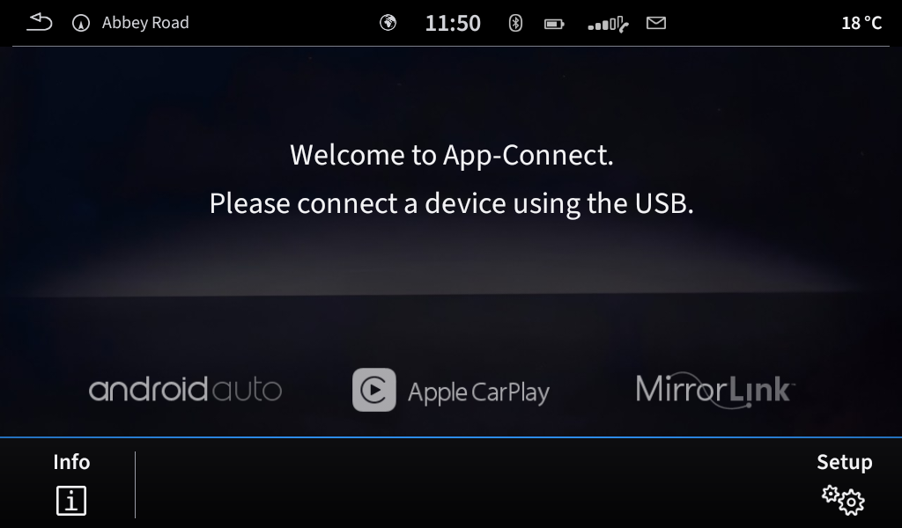 | 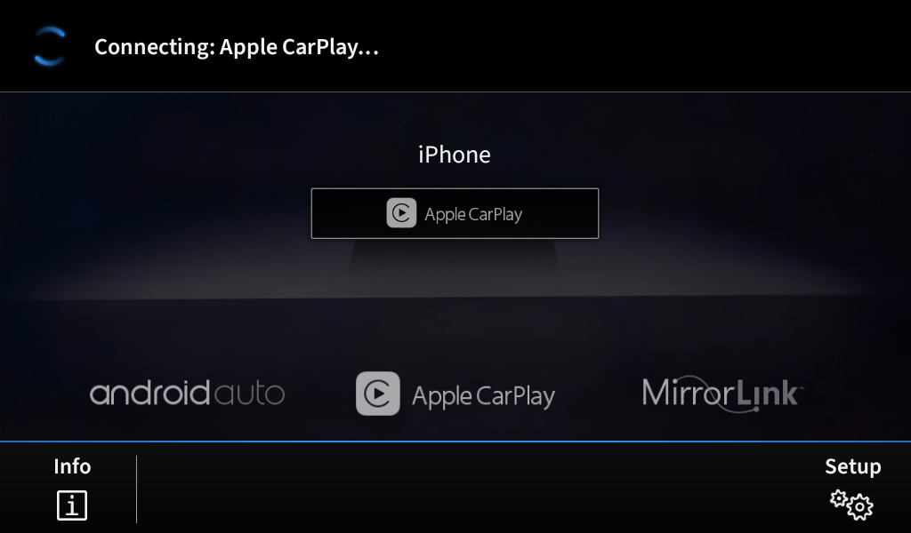 | 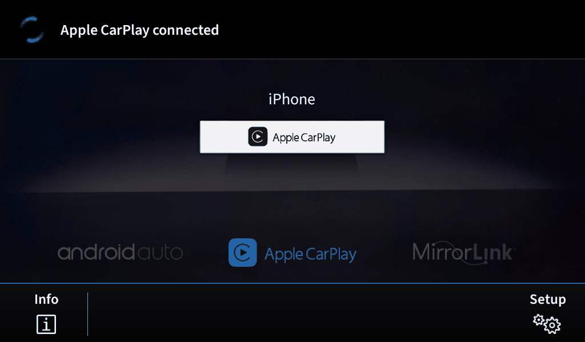 |

### Vehicle (CAR)

Paged with the **<** **>** boxes like the factory menu. Everything comes from GPS and what you
enter; no diagnostic adapter is needed.

| Page | Contents |
| --- | --- |
| **Vehicle status** | The car picture with reminders: oil change, annual service, registration expiry, winter tyres (1 Nov – 1 Apr), low fuel. Otherwise *No entries.* |
| **Since start** | Driving time, distance, average and current speed, heading and altitude (GPS). |
| **Long-term** | Totals across trips, plus the odometer. |
| **Since refuelling** | Distance, average consumption, range, last fill-up, cost per 100 km, average fuel price. |
| **Fuel** | The fuel log: add a fill-up at the pump (litres, price, odometer). |
| **Service** | Odometer, next oil change (km and date), annual service, registration date, tyres, tank size. |

| Status | Since refuelling | Fuel log | Service |
| --- | --- | --- | --- |
|  |  |  |  |

*Setup → Vehicle* sets the brand and model and lets you pick your own car picture (Vehicle status)
and interior picture (Ambient lighting). The launcher lists the pictures itself, with previews,
from the unit and from USB sticks (newest first), because many head units have no system picker
that returns a result to a home app; *Another app* still opens the gallery or a file manager. The
picture is applied straight away and the screens that show it are rebuilt; *Back to built-in*
restores the original.

### Ambient lighting

A clean picture of the car's interior with a 30-colour slider along the bottom and a brightness
key (100 / 80 / 60 %). The chosen colour is used as the launcher's accent colour.


### Bass – Mid – Treble

Three factory-style sliders from −9 to +9, applied with Android's `Equalizer` to the built-in player and
the global audio session. *Reset* puts all three back to 0.


### Apps

All installed apps as tiles. Long-press a tile to add it to MENU or to use it as the phone or radio
app. The factory Bluetooth music app, which has no launcher icon, is found and listed too, along
with a **Bluetooth audio** tile that switches the media player to BT.


### Settings

*System settings*: screen, ambient lighting, time and date, language, units, navigation (offline
maps, map style, voice, home / work), sound, media (library, All files access, other media apps),
radio (LOC, RDS, station logos), Bluetooth audio, phone app, vehicle (brand, model, pictures),
App-Connect, phone and radio apps, Android settings, diagnostics and system information.

| Settings | Vehicle | Bluetooth audio | Radio |
| --- | --- | --- | --- |
|  | 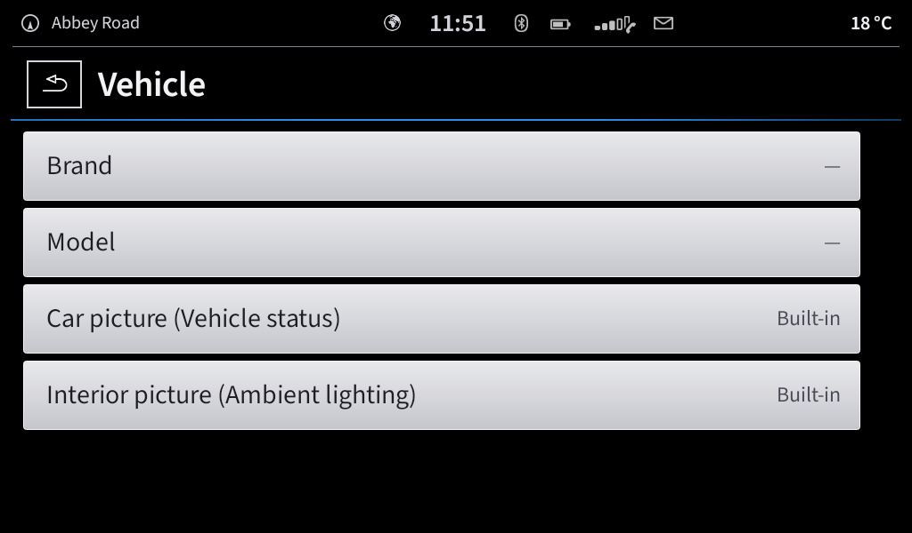 | 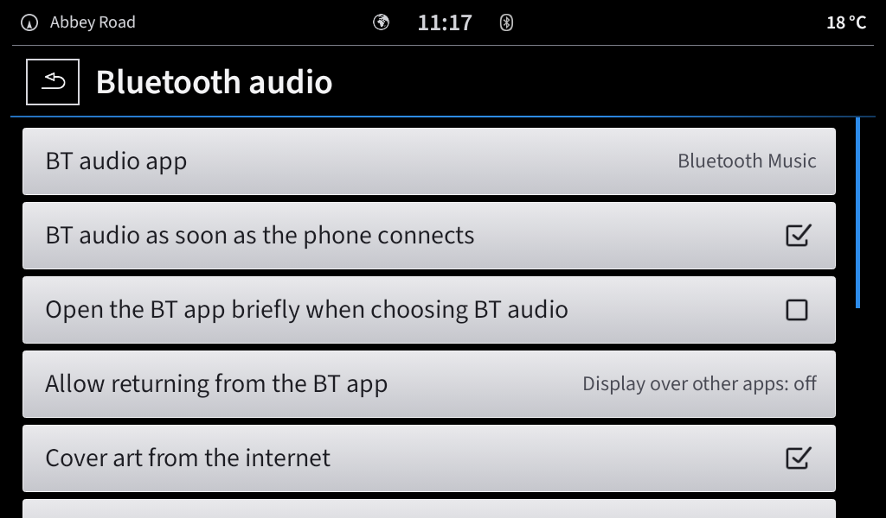 | 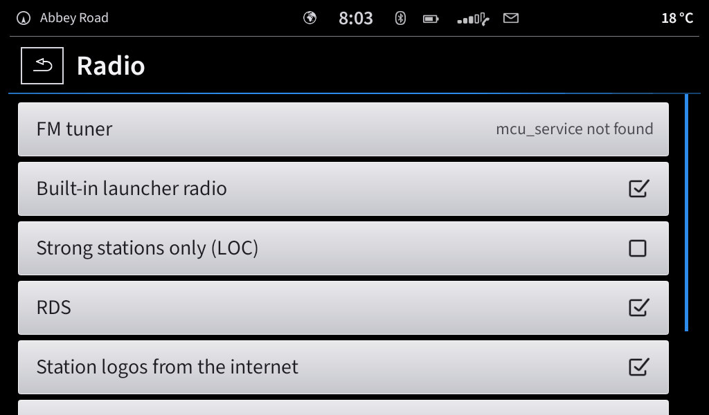 |

### Back

Back (the hardware key, the arrow in the status bar or a page's own back box) always returns to the
screen shown before, like a phone: Media → Setup → back lands on Media again, Navigation → Media →
back lands on Navigation. Inside a screen it first closes what is open there (a settings sub-page, the
media browser, the station list). MENU clears the trail.

### Loading banner

Anything that takes a moment drops a black banner, two status bars tall, from the top: the factory
spinner (in the ambient colour, turning clockwise) and a line saying what is happening, e.g.
*Searching for radio stations… 4 · 94.8 MHz*, *Reading music from USB…*, *Downloading map: 34 %*,
*Calculating the route…* or *Connecting: Apple CarPlay…*. It slides away when done and never
blocks taps.

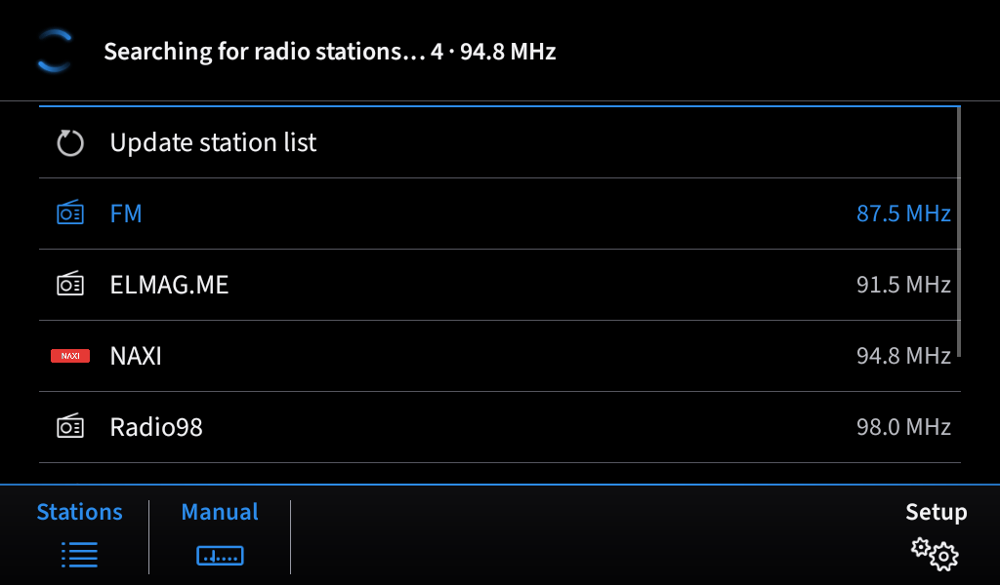

### Status bar

From left to right:

- **Back arrow** on pages that have no back key of their own.
- **Compass and street name**: the current street from GPS and reverse geocoding. Tap it to go
  to MENU.
- **Globe**: shown dimmed when there is no internet.
- **Clock**.
- **Phone icons**: FM while the radio plays, the **Bluetooth** icon, phone **battery**,
  **signal**, and an **envelope** when the phone has notifications. Tap the envelope to list
  them.
- **Outside temperature** on the right: the current weather at the car's position (Open-Meteo,
  refreshed every 15 minutes).

The text and icons are a touch dimmer than the screen content, like the factory screen.


---

## Install on the head unit

1. Download **TheCarLauncher.apk** from the latest release on the [Releases page](../../releases).
   Every push builds one automatically (`build-N`).
2. Copy it to a USB stick, or download it on the unit, and open it. Allow *Install unknown apps*
   if Android asks.
3. Press the unit's Home button and pick **Car Launcher** → *Always*
   (or *Setup → Android system → Default launcher*).

Requires Android 5.0 or newer.

## First-time setup

| Permission | Why | Where |
| --- | --- | --- |
| Location | Map, speed, street name, trip computer | Asked on first start |
| Music / storage | Local songs from internal storage and indexed cards | Asked on first start |
| All files access (Android 11+) | Reads USB sticks and SD cards as folders, since many head units never add them to Android's media index | Opened once after the first permission dialog; also *Setup → Media → All files access (USB)* or by tapping *No media* in Browse |
| Notification access | Song info from other media apps, phone notification envelope | *Media → Source → Connect apps* |
| Bluetooth (nearby devices) | Phone status on Android 12+ | Asked on first start |

Then, in *Setup*:

- **Bluetooth audio**: choose *BT-audio* in Media and play something on the phone to check that
  the title shows.
- **Radio**: check that *FM tuner* says it is available.
- **Vehicle → Service**: enter the odometer, the oil-change interval and the registration
  date so the reminders work.

---

## How it talks to the head unit

| Part | How |
| --- | --- |
| **FM tuner** | `mcu_service` / `IMcuManager` through reflection, using the tuner protocol documented by [OpenRadioFM](https://github.com/kapi21/OpenRadioFM) (Apache-2.0, see `NOTICE`). MCU channel 2 = FM, 4 = Android media. |
| **Bluetooth song info** | From the factory BT service: `com.qf.action.BT.MUSIC.INFO` broadcast (`songName`, `songSinger`, `songAlbum`), system properties `sys.qf.bt.music.progress` and `sys.qf.bt.is.connect`. Controls through `com.qf.action.BT.MUSIC.CONTROL`. The launcher only writes `AT#MK` (song info request) to `/dev/goc_serial`. With direct reading turned on (units without the factory app) it parses the module's AT protocol itself: `MI` song, `MT` position/length, `MB`/`MA` playing/stopped, `PS` signal/battery, `IB` connected, `MY`/`IA` disconnects. |
| **Factory media info** | The factory media apps' `UPDATE_MEDIA_INFO`, `UPDATE_MEDIA_STATE`, `BT_STATE` and `UPDATE_ACTION` broadcasts, as a fallback. |
| **Other players** | Android `MediaSession`s, found through the notification listener. |
| **Fullscreen** | `LAYOUT_FULLSCREEN` plus `WindowInsetsController`; the UI scale is recalculated for the real screen size. |

---

## Building

### With Gradle (Android SDK installed)

```sh
./gradlew assembleRelease
# -> app/build/outputs/apk/release/app-release.apk
```

GitHub Actions (*Build APK*) runs this on every push and publishes the APK as a release named
`build-N`.

### Without Gradle or the official Android SDK

Uses Debian/Ubuntu packages only; see `scripts/build-local.sh`:

```sh
sudo apt install aapt dalvik-exchange zipalign apksigner
ANDROID_JAR=/path/to/android-all-14.jar FRAMEWORK_RES=/path/to/framework-res-34.zip \
  scripts/build-local.sh
# -> build/TheCarLauncher.apk
```

Both builds sign with `keystore/release.jks`, so either APK installs as an update over the other.
That key is committed on purpose so builds stay update-compatible. It is fine for a personal head
unit, but don't reuse it for anything published.

### Tech notes

- Plain Java 8 source, no AndroidX. The only libraries are the offline-map jars in `app/libs/`.
- `minSdk 21`, `targetSdk 34`.
- `versionName` / `versionCode` live in `app/build.gradle`.

---

## Project layout

```
app/src/main/java/com/thecarlauncher/
├── LauncherActivity.java   screens, status bar, fullscreen, permissions
├── apps/                   installed apps, hidden BT music screens, launching
├── car/                    CarData: odometer, fuel log, service reminders
├── media/
│   ├── MediaHub            the single source of truth for "what is playing"
│   ├── MusicService        built-in player (MediaSession, audio focus)
│   ├── MusicLibrary        songs / albums / artists / folders from MediaStore
│   ├── GocBluetooth        BT song info: factory service broadcast / properties, goc_serial
│   ├── BluetoothSource     factory BT app discovery, background start, media keys
│   ├── CoverArt            online cover lookup with disk cache
│   ├── QfMediaBridge       factory media broadcasts
│   ├── PhoneStatus         phone battery / signal / notifications for the status bar
│   ├── MediaListenerService notification listener (other players' sessions)
│   └── Tone                Bass / Mid / Treble
├── mib/                    UI widgets: tiles, soft-key bar, pager, popup, progress, cover glow
├── nav/                    OsmApi (Nominatim, OSRM, Overpass), Guidance (TTS, re-route), GPS,
│                           OfflineMaps (download + on-device drawing of mapsforge files)
├── radio/                  tuner driver, RadioController, FmScaleView, McuSniffer
├── screens/                Menu, Media, Radio, Nav, Vehicle, Ambient, Sound, Apps, Settings
├── util/                   Prefs, Ui, Theme
└── views/                  MapTileView, TileCache
app/src/main/res/drawable-nodpi/   UI artwork (ui_*.png), car pictures (car_*.png)
app/src/main/assets/fonts/         Source Sans 3 (OFL)
docs/screenshots/                  README screenshots
scripts/build-local.sh             Gradle-free build
```

---

## Testing and screenshots

Screens are checked with **Robolectric** at 800×480, 1024×600 mdpi and 1024×600 hdpi. The test
drives every screen, simulates GPS, media sessions, factory broadcasts and Bluetooth module replies (for example
`MT0001146900214000` → 0:11 of 3:34), and saves a screenshot of each.

The screenshots in this README come from that harness, in English, with a made-up location
(Abbey Road, London) for privacy. That is why the radio shows *tuner not available* and system
information shows *robolectric*.

---

## Troubleshooting

| Problem | What to try |
| --- | --- |
| BT music plays but no title shows | Check that *Read the BT module directly* is **off**, then restart the unit. *Diagnostics* should show the song under *Song from BT app (broadcast)*. Send a photo of that page with a bug report. |
| BT audio doesn't start when the phone connects | *Diagnostics* → `sys.qf.bt.is.connect` should read `true`; check *BT audio as soon as the phone connects*. |
| No sound after choosing BT-audio | Turn on *Open the BT app briefly (if there is no sound)* as a fallback. |
| The BT app opens and stays on screen | Allow *Display over other apps* for Car Launcher (*Setup → Bluetooth audio → Allow returning from the BT app*). |
| Calls stop working in the factory app | Report it with the *Potential issue* form. |
| No cover art | The unit needs internet. Songs whose "artist" is a video channel name may not be found. |
| Radio tile opens another app | `mcu_service` wasn't found. *Setup → Radio* shows the tuner status. |
| Other apps' songs don't show | Enable notification access: *Media → Source → Connect apps*. |
| The launcher isn't Home after a reboot | *Setup → Android system → Default launcher* → Car Launcher → *Always*. |

---

## Status on real hardware

| Feature | Status on the head unit |
| --- | --- |
| BT song title / artist / album / position from the factory service | Confirmed (4.2.3) |
| BT controls through the factory control broadcast | Confirmed (4.2.3) |
| BT audio when the phone connects / when opening Media | Confirmed (4.2.5) |
| Bluetooth devices: list, connect, pair a new phone | New in 4.3.0, needs testing |
| Back to the previous screen | New in 4.3.1 |
| Smooth arrow, driving direction up, offline street names | New in 4.4.0, needs testing |
| Choosing car / interior pictures inside the launcher | New in 4.4.1 |
| UI, MENU, status bar, fullscreen | In daily use |
| App-Connect connection states and auto-open | New in 3.9.0, needs testing with a phone |
| Station logos (Radio Browser) | New in 4.0.0, needs testing on the unit's connection |
| Cover art lookup | New, needs testing on the unit's connection |
| Clearing the song on phone disconnect | Relies on `sys.qf.bt.is.connect` |
| USB sticks read as folders (All files access) | New in 3.3.0, needs testing |
| Offline maps (download + drawing) | New in 3.4.0, needs testing with a real country map |
| FM radio through `mcu_service` | Implemented from the OpenRadioFM protocol |

---

## Reporting issues and ideas

Open [**Issues → New issue**](../../issues/new/choose) and pick a form:

| Form | Use it for |
| --- | --- |
| **Bug report** | Something is broken or behaves wrongly. Asks for the area, steps, version, head unit and photos. |
| **Feature request / change** | A new feature, or a change to how something looks or works. |
| **Potential issue / risk** | Something that isn't broken yet but could be: untested features, side effects, driving safety, privacy, other units. |

For Bluetooth problems, attach a photo of *Setup → Bluetooth audio → Diagnostics*.

---

## Artwork and licences

- **Artwork.** The icons, tile artwork and car pictures in `app/src/main/res/drawable-nodpi/`
  (`ui_*.png`, `car_*.png`) were supplied by the project owner for this personal, non-commercial
  launcher. They remain the property of their respective owners. All trademarks belong to their
  owners; no affiliation or endorsement is implied.
- **Font.** Text uses **Source Sans 3** (SIL Open Font License,
  `app/src/main/assets/fonts/OFL.txt`) as a stand-in for the factory typeface.
- **FM radio protocol.** The tuner protocol is from OpenRadioFM (Apache-2.0); see `NOTICE`.
- **Offline maps.** Drawn with the [mapsforge](https://github.com/mapsforge/mapsforge) libraries
  (LGPL-3.0, unmodified jars in `app/libs/`, licence texts in `licenses/`) and AndroidSVG
  (Apache-2.0). The map style `app/src/main/assets/maptheme/stock_day.xml` is original to this
  project. Map files from `download.mapsforge.org`, data © OpenStreetMap contributors (ODbL).
- **Online map tiles.** Without a key the online map uses OpenStreetMap's own tiles. CARTO's
  styles (day / night) need a free CARTO API key since 2026, entered under *Setup → Navigation →
  CARTO key*; without it CARTO draws "API KEY REQUIRED" on every tile.
- **Map data.** © OpenStreetMap contributors, tiles styled by © CARTO, cached on the unit for 30
  days. Search by Nominatim, routing by OSRM (FOSSGIS), places by Overpass.
- **Cover art.** Covers are fetched from public music catalogue search results, for display only.
